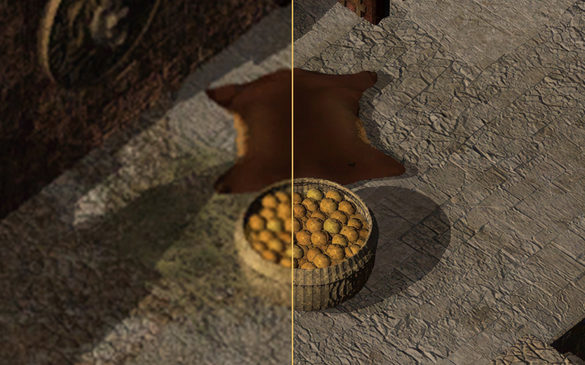
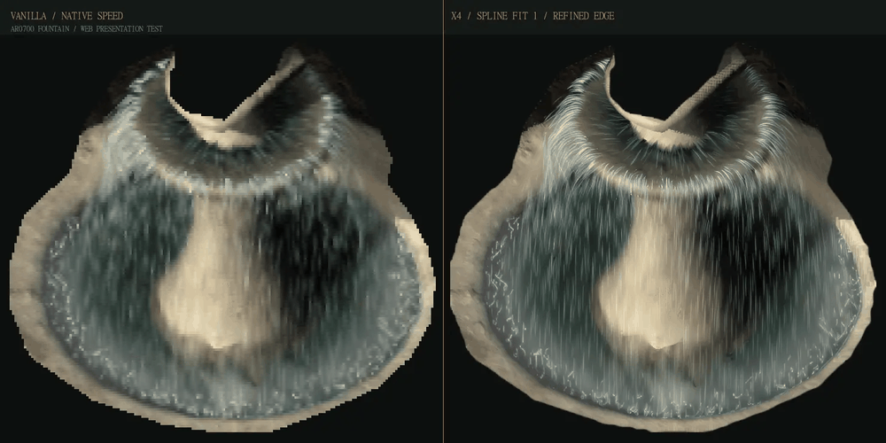
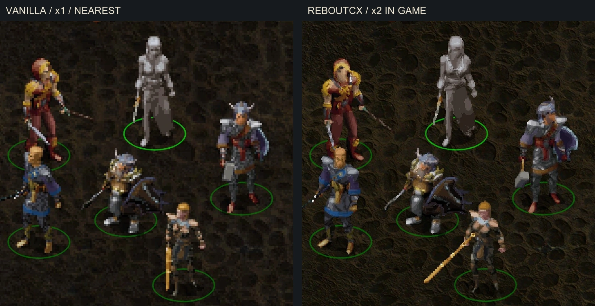
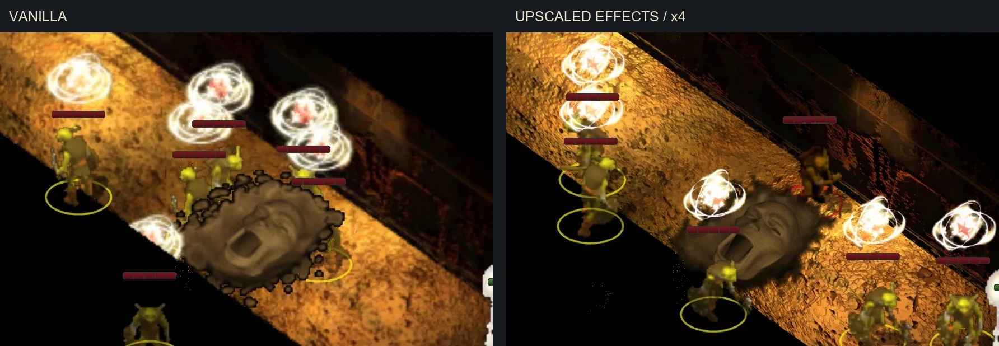

# BG2 HD Visual Project

An unofficial, free, non-commercial visual enhancement project for **Baldur’s Gate II: Enhanced Edition**, created by Gaurox.

The project combines **×4 environments**, improved environmental animation and **×2 Q3M creature sprites**, with local AI processing and individual in-game review. The aim is to bring out the detail in the original artwork while preserving its composition, colours and distinctive atmosphere. Gameplay and the original artistic direction remain the reference.

**[Explore the website](https://bg2hd.gaurox.dev/) · [Interactive gallery](https://bg2hd.gaurox.dev/gallery) · [Development progress](https://bg2hd.gaurox.dev/progress) · [News](https://bg2hd.gaurox.dev/news)**

> **Work in progress — no public installable release yet.** A free fan release is planned for 2027, subject to final validation and packaging.

## Visual comparisons

### Environments at four times the resolution

*AR0700 · Waukeen’s Promenade, daytime. One continuous close-up with a central divider: vanilla on the left, ×4 on the right. The stonework and ground textures show the change in detail directly across the split.*

### Environmental animation

*Fountain motion study from the website: vanilla on the left; ×4 detail, interpolated motion and a rebuilt transparency contour on the right. This isolated animation preview shows the treatment outside the game.*

### Creature sprites in game — vanilla nearest / ReboutCX ×2

The website’s in-game comparison shows the same party with **vanilla ×1 sprites using nearest filtering** and the **installed ReboutCX ×2 sprite set**, at the same displayed size. Armour, faces and equipment become more defined in the actual game scene. The project’s later Q3M work builds on ReboutCX-generated detail with palette-aware encoding, preserving character colours and runtime recolouring. [Explore the sprite work](https://bg2hd.gaurox.dev/sprites).

*Website captures from 21 September 2026, cropped around the same party; animation poses differ slightly. Left: vanilla sprites with nearest filtering. Right: ReboutCX ×2 sprites; the background map is also upscaled ×4. [View the full comparison](https://bg2hd.gaurox.dev/gallery#sprite-party-three-way).*

### Spell effects in game

*Horror spell · matched in-game framing, cropped around the effects. The captures use slightly different animation frames. Maps and environmental animations are also treated on the right; creature sprites remain vanilla.*

These four comparisons are adapted from the [website gallery](https://bg2hd.gaurox.dev/gallery). Visit the site for full-size images, interactive comparisons and video playback.

## What the project improves

| Domain | Approach |
|---|---|
| **Maps** | ×4 upscaling with SeedVR2 7B, rebuilt into game tiles. Doors, alternate states, day and night retain their own artwork and checks. |
| **Water** | Map-specific treatment of artwork, animated overlays and foreground contours. Suitable cycles are rebuilt for 30 FPS while preserving local shadows and reflections. |
| **Environmental animations** | ×4 detail, separate transparency repair and interpolation toward 30 FPS where suitable, preserving placement and cycle duration. |
| **Creature sprites** | ×2 Q3M shading with native palettes, equipment layers and runtime recolouring. The selected Character rendering uses BOX filtering. |
| **Spell effects** | ×4 frames, rebuilt glow and transparency, and smoother motion where suitable. Every retained effect is reviewed in game. |
| **Other visuals** | UI and HUD, videos, icons, projectiles and cursors are tracked separately; their progress varies from initial research to early accepted results. |

Process pages: [Maps](https://bg2hd.gaurox.dev/maps) · [Water](https://bg2hd.gaurox.dev/water) · [Animations](https://bg2hd.gaurox.dev/animations) · [Sprites](https://bg2hd.gaurox.dev/sprites) · [Effects](https://bg2hd.gaurox.dev/effects).

## How it works

AI models run locally. SeedVR2 is used for scenery and environmental detail; sprite work combines ReboutCX targets with palette-aware Q3M encoding. Claude and Codex helped build the pipelines and investigate rendering constraints. Local automation handles extraction, processing and rebuilding; visual acceptance stays with the project author.

An asset needs more than a sharp still image. Loops, transparency, colour changes, equipment layers, foreground masking and day/night behaviour must remain coherent inside BG2EE. Settings are adapted to the asset: a non-generative resize or the native result can be retained when it works better.

The project also develops its own modifications to **InfinityEngine-Enhancer** to display HD resources while preserving native geometry and palette behaviour.

## Current progress

**Public website snapshot: 7 October 2026.** Figures are provisional and refer to distinct scopes, not to a finished release.

| Domain | Reported milestone |
|---|---|
| Maps | **400 / 400 map variants** built and accepted in game. |
| Water-map treatment | **63 / 63 active WED water variants** processed and accepted; included in the map scope. Water engine tuning remains in progress. |
| Q3M sprites | **15 / 15 families**, covering **331 / 331 creature variants** in the retained native scope, accepted in game. |
| Environmental animations | **184 / 246 results retained**, including native selections; **139** current QA selections accepted in game. |
| Spell effects | **3 / 494 assets** built and accepted in game. |
| Other categories | Early UI results and video method checks; icons await QA, while projectiles and cursors have not started. |

Produced assets, in-game acceptance and inclusion in a release are tracked separately. Completed map and sprite milestones do not mean the full mod is ready. See [the progress page](https://bg2hd.gaurox.dev/progress) for the complete breakdown and [news](https://bg2hd.gaurox.dev/news) for dated updates.

## Release plans

The planned release is **free and non-commercial**, with a target of **2027**. Final work includes reviewing the complete configuration, correcting remaining defects, measuring performance, validating installation and restoration, and checking compatibility. Linux deployment is planned for investigation; support has not yet been established.

There is currently **no public installable mod**. The website presents development results; this repository is the source and development workspace.

## Repository

This repository contains pipeline scripts, engine source, inventories, technical research and release metadata. Large production outputs and AI model weights are stored outside Git; selected previews and references are included.

- [Map pipeline](pipeline/README.md)
- [Environmental animations](animations/README.md) and [effects](effects/README.md)
- [Sprite pipeline and research](sprite/README.md)
- [Engine source](engine/InfinityEngine-Enhancer/source-patchee/README.md)
- [Release development](releases/BG2-HD-Upscale/README.md)
- [Website source](https://github.com/Gaurox/bg2-hd-website)

The README is in English; some technical documents and historical research are in French. Questions and feedback are welcome through [GitHub issues](https://github.com/Gaurox/BG2-HD-Visual-Project/issues).

## Credits and licensing

Original project code and documentation by Gaurox are available under the [MIT License](LICENSE). Upstream engine code and dependencies retain their respective licenses; see [third-party notices](THIRD_PARTY_NOTICES.md).

Game artwork, captures and derived HD assets retain their respective third-party rights and are excluded from the MIT grant. The planned non-commercial fan release policy applies to the asset package, not to reuse of MIT code.

This project is not affiliated with Beamdog or the rights holders of *Baldur’s Gate*.
