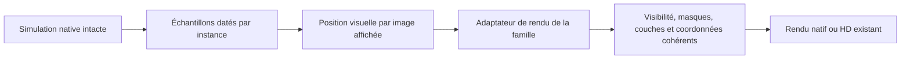

# Étude — interpolation généralisée des déplacements de projectiles

- Demande : étudier un correctif moteur commun à tous les déplacements de projectiles, distinct de l’interpolation des images. **Étude terminée ; aucun prototype installé.** DLLV9, images, PRO, sauvegardes et release inchangés.
- Conclusion : **service commun réalisable à prototyper ; couverture universelle non démontrée par un seul hook.** Traitement par instance/classe/phase ; valable pour rendu natif etHD, indépendant du resref et des productions disponibles.
- [Résultat chiffré/SHA](summary.json), [243descriptions](coverage-243.csv), [78IDs natifs sansPRO](engine-78.csv), [classes/RVA/signatures observées](native-classes.json). `python -B projectiles/analysis/deplacement-generalise-etude-20261028-v1/analyse.py` a été exécuté ; dossier historique, ne pas réécrire.

## Établi dans cette installation

| DescriptionsPRO | Classe prédite par le décodeur natif | Rendu observé dans les vtables |
|---:|---|---|
|98|CProjectileBAM|RVA0x233F20|
|143|CProjectileArea|mêmeRVA0x233F20|
|1/SCORCHER|CProjectileNewScorcher|RVA0x234520|
|1/SKYBOLT|CProjectileSkyStrikeBAM|RVA0x2352F0|

- Total243 ; **241descriptions convergent vers le rendu BAM**, pas241instances mobiles validées. Les zones peuvent être fixes, en vol puis fixes, ou n’avoir aucun BAM de vol.195descriptions déclarent un BAM de vol ; présence ≠ déplacement réel.
-238PRO ont253liaisonsPROJECTL ; toutes passent par la branche de chargementPRO du décodeur installé.5PRO sans liaisonPROJECTL : DBFIREBL,FBFLAMES,FBFLAMGR,FBFLAMIC,LIGHTBLT ; ne pas les compter comme chemins ingame observés.
- Modificateurs locaux (non exclusifs) :17hit-immediately,2pass-target,1bounce,1comet,1line,1pillar. Aucun flagmultiple/random/falling dans ces243 ; **cela n’exclut pas** les multiples/arcs/chutes codés en dur parmi les78IDs natifs, ni les enfants créés à l’exécution.
- Le binaire confirme des positions nativesXYZ etdes déplacements dansAIUpdate : `BAM-update-excerpt.txt` notamment écrit X/Y à0x228B87/0x228B8B etla hauteur à0x228C0C. `BAM-render.txt`/`BAM-render-FXRect.txt` montrent calcul de rectangle, visibilité, halo,ombre,clip puisFXRender. Décaler seulement le quad final arriverait trop tard.
- Points candidats : BAM AIUpdate0x228650 ; Area AIUpdate0x2284B0 ; RenderBAM0x233F20 ; SpellHit AIUpdate0x229FD0/Render0x2356B0 ; autres dans `native-classes.json`. Ce sont **des observations binaires, pas des contrats de hook prêts** : ABI, prologue complet, détoursEEex, destruction et concurrence restent à qualifier. Toute future adresse/signature doit être centralisée dans `game/build_manifest.*`.
- Les commentaires d’adresses des scriptsEEex copiés dans le jeu ne correspondent pas tous à ce binaire ; les vtables ci-dessus sont retrouvées via les constructeurs réels. Ne pas recopier leurs anciennes adresses littérales.
- [Contrôle V9 existant](../vol-animation-mouvement-20261028-v1/README.md) : animationTRAVEL12phases/6intermédiaires à30FPS, **pas une mesure de la position**. Présentation observée ~59,7FPS en régime établi ; démarrage plus lent. Cadence native du mouvement encore inconnue ; ne pas déduire15/30Hz depuis la cadence desBAM.

## Architecture proposée

1. **Acquisition** : observer les transitions natives à la frontière de mise à jour réelle ; produire des copies de position/hauteur, direction, phase, cible,aire, identifiant et génération. Le rendu lit un buffer publié ; pas d’écriture temporaire dans `m_pos`, même pendantRender. Pas de second AIUpdate sur une copie : effets/sons/hasard/collisions ne sont pas purs.
2. **Identité** : `(session,aire,objectID,génération)` +adresse/classification ; jamais le seul BAM ni un pointeur recyclable. Deux missiles du même sort gardent leurs historiques distincts. Lifecycle depuiscréation/retrait/destruction, garde post-update si l’objet s’est détruit ; purge aux chargements/changements de zone.
3. **Horloge** : temps natif d’update +QPC +numéro d’image présentée. Mesurer la cadence réelle, tenir compte du réglageAI EEex ; `m_gameTime` seul peut ne pas identifier chaque mise à jour. Le clock d’animation HD reste séparé. Cible : une position à **chaque image affichée**, donc potentiellement60FPS avec des images animées à30FPS.
4. **Calcul** : interpoler les segments **observés** enXYZ/hauteur ; pas une nouvelle droite caster→cible qui effacerait homing, arcs, chutes ou rebonds. Couper l’historique aux rebonds/téléportations/changements de phase ; un segment qui traverse ces événements n’est pas lissable sans leurs points intermédiaires.
5. **Projection** : travailler en coordonnéesmonde, puis appliquer caméra/zoom natifs actuels. Conserver une fraction de pixel jusqu’aux sommetsGPU ; l’ABI finale actuelle prend desentiers, arrondir trop tôt peut conserver les saccades lentes.
6. **Intégration** : même position visuelle pourvisibilité/rectangle/culling, clippingWED, couche principale, halo etprojections. Ombre : déplacementXY mais pas le delta de hauteur du sprite. Vérifier le tri devant/derrière les créatures. Si le masque ou le rôle des couches ne peut pas suivre, garder ce passage natif etjournaliser le motif.
7. **Compositions** : le FBO complet ne peut pas toujours être translaté d’un seul vecteur (ombre au sol, sprite enhauteur, préfixe natif). Adaptateur en amont des soumissions par couche ; pas un simple déplacement dans `RenderTexture` après masque.
8. **Rendu natif/HD** : même service, sans `read_registered_effect_resref()` comme condition d’éligibilité au mouvement. Réutiliserles textures/caches actuels ; ne pas mettre les coordonnées variables dans une clé de textureGPU et ne pas créer une texture par position.

## Compromis temporel à décider et mesurer

| Méthode | Gain | Coût réel |
|---|---|---|
|Interpolation entre deux états connus avec tampon|Robuste, sans inventer le futur ; base recommandée pourle prototype|Retard visuel d’environ un intervalle d’update ; raccord final àtraiter|
|Extrapolation depuis vitesse/derniersegment|Pas de retard délibéré|Peut dépasser mur/cible/rebond ; correction au prochainétat ; ne convient pas comme solution universelle silencieuse|
|Segment futur déjà calculé par une classe native|Interpolation sans prédiction aveugle pour cette classe|Disponibilité et événements intermédiaires à démontrer ; pas une hypothèse commune àtouteslesclasses|

- Exemple **hypothétique**30updates/s/60images/s/12pixels parupdate : tampon≈33,3ms/12pixels de retard ; extrapolationdemi-intervalle≈6pixels susceptibles d’être erronés. [Calcul illustratif](latency-example.json), pasmesureingame.
- Recommandation prototype : **interpolation tamponnée**, correction vers la position terminale au moment natif de l’arrivée/rebond/retrait ; ne pas maintenir un faux projectile après destruction. Conséquence : possible saut final borné par le segment retardé. Mesurer et accepter explicitement ce compromis visuel ; ne pas promettre simultanément retardnul, zéro correction et futur exact.
- Dégâts, collisions, temps de déclenchement, sons etvitesse native ne sont pas retardés. Retarder aussi explosions/sons rendrait l’ensemble visuel pluscohérent mais constituerait un autre changement ; ce n’est pas la propositioninitiale.
- Pause : geler le dernier état visuelmonde, caméra encorelibre ; reprise rebasehorloge. TimeStop : respecter l’activité réelle de chaque objet, pas seulement le pauseglobale. Vitesse native/ralentissements/retard réseaux : pas de `dt=1/30` fixe ni rattrapage à travers un obstacle.

## Couverture par adaptateurs

| Famille visuelle | Traitement |
|---|---|
|Flèches, carreaux, orbes, boules, vols BAM/Area|Premier adaptateurcommun ; native etHD, uniquement phaseenvol|
|Missiles multiples/courbes/homing|Chaque enfant possède sa trajectoire ; ne pas lisser le conteneur seulement ; resets aux changements natifs|
|Comète, chute, frappes verticales|ÉchantillonsXYZ ethauteur, ombre dissociée ; RenderSkyStrike etclasses natives spécifiques|
|Rayons/chaînes/scorchers|Extrémités/segments reliés ; translater toutlefaisceau casserait sonattachement aux cibles|
|Fumées ettraînées|Anciens panaches restent oùilsontétéémis ; éventuellement lisser leur mouvement propre. Synchroniser l’origine d’une nouvelle émission avec l’émetteurvisuel sans doubler les émissions|
|Fragments/particules|Leur propriétaire natif,hauteur,gravité etdurée ; adaptateursCGameAnimation/CParticle si trajectoires distinctes|
|Nuages fixes, explosions, impactsinstantanés|Aucune translation artificielle. Distinguer mouvement ducentre, expansion etanimation desimages ; seuls les mouvements natifs réels relèvent duservice|
|VEF/VVC autonomes|Identifier le propriétaire ; ne pas attribuer au parent un enfant doté d’une vitesse native indépendante|

## Chemin de mise en œuvre et critères utiles

- **Étape1 — sonde de coordonnées en lecture seule** : quelques instances sélectionnées, bufferborné ; à chaqueupdate etchaquerendu/swap : instance/génération/type/phase,serialupdate/QPC,pause/TimeStop,nativeXYZ,caméra/zoom,positionvisuelle proposée,puis position réellement soumise. Pas de déduplication par phaseBAM : un même sprite peut se déplacer à chaque image. Déterminercadencenative,répétitions etfinsdevol avant detoucherlerendu.
- **Étape2 — prototypeBAM/Area** : codecommun dans `core/projectile_motion.*`, adaptations danshooks, configuration indépendante `ProjectileMotionMode=off|observe|interpolate` proposée ; aucune option encoreajoutée. Garder natif pour état/champ/masque non reconnu. Cap initial de conception4096instances,≈1Mio pour deuxbuffers de128octets/instance ; dépassement→natif, pasd’allocationincontrôlée.
- **Étape3 — classesdistinctes** : faisceaux/chaînes,verticales,émissions/particules ; ne pas annoncer « tous » tantque les lignes `engine-78.csv` pertinentes ne sont pas reliées à unadaptateur.
- **Validation du noyau quand il existe** : `dt` variable,pause/reprise,tempsinversé,session/IDrecyclé,rebond,terminaison,hauteur/ombre,capacité. Pasde tests d’implémentation fictive ajoutés pendant cetteétude.
- **Essais par familles**, pas243retests : volTRAVELlent ;flèche rapide ;missilemultiple surciblemobile ;rebondcontreparoi ;comèteverticale ;rayon attaché àciblemobile ;fumée/fragmentavecobstacle. Ajouter pause/TimeStop,caméra,zoom,FPSvariables etrafale surquelquescas ; commandes àsélectionnerdepuisSPL/ITMexistants lorsduprototype.
- **Preuve attendue** : positions finalesintermédiaires effectivementprésentées entre deux étatsnatifs ;pasuniquement phasesBAM oucoordonnées calculées nonutilisées. Distinguerpositionnative,positionvisuelle etcaméra. Vérifierdernierdessinvol/premierimpact/événementnative,pasdefantôme,masqued’obstaclecohérent,ombrecohérente,CPU/mémoirebornés. La simulation doit recevoir lesmêmesdonnées, sansécriture demouvementvisuel dansl’étatdujeu.
- LesQAimages précédentes restent acquises àoctets inchangés ; le nouveaucontratmouvement exige saproprevalidation. L’étuden’accorde aucunétatQA/installation/release.

## Sources et limites

- Binaire `config://bg2ee_game_root/BaldurReal.exe` etfichiersPRO actifs :SHA `summary.json`. ScriptsEEex locaux `EEex/copy/EEex_scripts/EEex_GameObject.lua`, `EEex_Projectile.lua`, `EEex_UncapFPS.lua`, `B3TimeStep.lua` : classes, options etcas de pause ; copiesinstallateur ≠ preuve d’activationdechaqueoption.
- Sources du renderer : `src/iee/hooks.cpp` (scopesBAM/Area/VVC,FXLock/FXRenderBam/FXRender,masquesWED,rendufinal), `frame_hook.*` (QPC/swap), `game/runtime_types_x64.h` (horlogemonde), `game/build_manifest.*` (contratsparbuild). Le rendu natif utilise positions ethauteur dansvisibilité/clip avantdessinfinal.
- [IESDP PRO](https://gibberlings3.github.io/iesdp/file_formats/ie_formats/pro_v1.htm) : sens des champs/combinaisons ; attention certains champs changent de rôle selon le mode, etleflagcourbe n’établitpas une courbe effective. [EEex structuresx64](https://eeex-docs.readthedocs.io/en/latest/EE%20Game%20Structures%20(x64)/CP/index.html#cprojectile) : positions/deltas/hauteur ethiérarchie ; offsetsindicatifs àrecouperaubinaire. Aucune adressex86 transposée enx64.
- Restes nonrésolus : cadencephysique réelle ; politique finale retard/impact ; accèsfinaux fractionnaires ; lifecycle detoutesclasses ; threadownership ; triocclusionentrecréaturesetprojectile ; compatibilité EEex effectivementchargé. **Faisabilitéargumentée, pas une modificationglobale déjàvalidée.**
